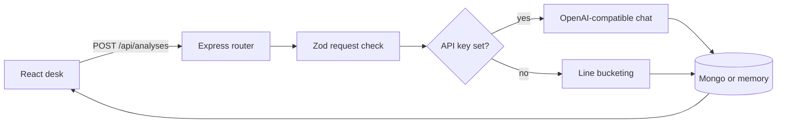

# Developer notes

This file is the map of the code. Read it before changing a route or the prompt. The product explanation for someone running the app is in [README.md](README.md).

## Shape

Two packages, one repo, npm workspaces.

```text
client/     React + Vite + Tailwind. Talks only to /api.
server/     Express. Owns validation, the model, and storage.
```

The client does not import server files. The analysis contract is duplicated in `client/src/types.ts` and `server/src/types.ts` on purpose. A shared package would be a third workspace for one interface. If you add a field, change both types and the Zod schema that actually enforces the model output.



## Request path

1. `client/src/App.tsx` submits the form through `client/src/api.ts` (axios).
2. `server/src/routes/analyses.ts` parses the body with `analysisRequestSchema`. A failed parse is a 400 with one sentence, not the raw Zod tree.
3. `clusterFeedback` in `server/src/ai/cluster.ts` either calls the model or `heuristicCluster`.
4. The store inserts the input plus the result. The response is the saved record, including its id, so the UI can select it without a second fetch.
5. Errors from the store or an unexpected throw hit the handler in `server/src/app.ts` and become a 500 `{ error }`.

`GET /api/health` is how the header knows whether it is showing a model name or the words "offline clustering". The handler does not return the API key.

TanStack Query owns the server list. The query key is `["analyses"]`. After a create or delete the mutation invalidates that key. `isPending` drives the button and loading text. There is no second copy of the list in `useState`.

## Model contract

`modelResultSchema` is the only shape we accept from a model:

- `themes` array of 3–6 items
- each item: `name` string, `quotes` string array (1–8), `action` string

`source` and `model` are set by our code after parsing. The model is not allowed to claim it is the offline checker, and the offline checker is not allowed to claim it is a model.

Flow inside `fromModel`:

1. Ask with `response_format: json_object`.
2. If that flag is rejected by the provider, retry the same prompt without it.
3. Strip optional markdown fences in `extractJson` and run Zod.
4. On invalid JSON, ask once more, quoting a clipped reason.
5. If that still fails, or the HTTP call fails, return the heuristic result and put the failure in the first theme's action. The user still gets a saved analysis, and the badge still says the result is offline.

The system prompt's important rule: every quote must be copied from the feedback, and no invented facts. That is the behavior you should be able to defend in an interview. The code does not have a second checker that proves the model obeyed. Zod checks shape, not truth.

Temperature is `0.2` so repeated runs on the same paste stay closer.

## Offline checker

`heuristicCluster` is not a miniature model. It does three things:

- Splits the paste on newlines and keeps lines of at least 8 characters.
- Buckets those lines into 3–6 groups by simple round-robin.
- Names each group with a tiny keyword guess (performance, bugs, usability, etc.) or a numbered fallback, and attaches a generic action from a fixed list.

Quotes are the original lines. It never invents a customer or a metric.

## Storage

`AnalysisStore` in `server/src/types.ts` is the seam: `insert`, `list`, `get`, `remove`.

- `createMemoryStore` keeps an array in the process. Newest first. Used when `MONGO_URI` is empty so `npm run dev` works with zero infrastructure. Data dies with the process. Say that out loud if you demo it.
- `createMongoStore` connects with Mongoose and maps `_id` to `id` at the edge. Callers never see an ObjectId. Invalid ids return null instead of throwing, so a bad id is a 404.

`connectStore` is the only place that chooses. Routes take an `AnalysisStore`, which is why `memory.test.ts` does not need a database.

Documents are not user-scoped. There is no account system. Do not store real feedback on a shared server until that exists.

## UI

`App` holds the form and the selected analysis id. The list comes from React Query. The selected analysis is an id into that list, not a second copy, so a delete cannot leave a stale detail on screen.

Timestamps the user sees are formatted with `formatDistanceToNow` from date-fns in `client/src/App.tsx`.

Styles are Tailwind utilities. There is no hand-written CSS design system.

## Library notes

- **Tailwind CSS** (`@tailwindcss/vite`): why it is here — all UI styling goes through utilities so the page stays focused on the paste action without a custom design system. Used in `client/src/App.tsx` (every className) and configured in `client/vite.config.ts` plus `client/src/index.css`. Interview question: how do you style a React app without shipping a large CSS file? Tailwind utilities compiled by Vite.
- **date-fns**: why it is here — every timestamp the user sees (createdAt) is formatted with it. Used in `client/src/App.tsx` via `formatDistanceToNow` and tested in `server/src/lib/dates.ts` / `dates.test.ts`. Interview question: interviewers still say "moment"; the answer is Moment is legacy, mutable, and heavy; this repo uses date-fns. Example: `formatDistanceToNow(new Date(createdAt), { addSuffix: true })` returns strings like "3 minutes ago".
- **axios**: why it is here — every API call from the client goes through it. Used in `client/src/api.ts` (`axios.create` and the get/post/delete methods). Interview question: how does the client talk to Express without raw fetch? A small axios instance with baseURL `/api`.
- **@tanstack/react-query**: why it is here — loading, creating, and deleting server data. Used in `client/src/App.tsx` (`useQuery` with key `["analyses"]`, `useMutation`, `invalidateQueries` after write, `isPending` on the button). Interview question: how do you keep the list in sync after a mutation without a second useState copy? Invalidate the query key.
- **Zod**: why it is here — request bodies and model JSON are validated with it. Used in `server/src/ai/schema.ts` (`analysisRequestSchema`, `modelResultSchema`) and parsed in `server/src/routes/analyses.ts` and `server/src/ai/cluster.ts`. Interview question: how do you reject bad model output before it reaches the database? Parse with Zod and retry once.
- **helmet**: why it is here — basic Express security headers. Used in `server/src/app.ts` (`app.use(helmet())`). Interview question: what is the first middleware you add for Express security? helmet.
- **cors**: why it is here — allows the Vite dev server to call the API. Used in `server/src/app.ts` (`app.use(cors())`). Interview question: how do you allow the frontend origin during development? cors middleware.

Redux Toolkit is for a large shared client cache this app does not have. React Query plus a little useState is enough.

## Tradeoffs

- In-memory fallback makes the repo runnable in a portfolio review. It is the wrong store for anything private or multi-instance.
- Falling back to the heuristic when the model fails keeps the demo alive. It can also hide a bad key. The action string is the signal. The health badge is the other one.
- Duplicated types will drift if you only edit one side. The API response is the runtime contract. TypeScript will not catch a client that forgot a new field until you use it.
- `Mixed` for the Mongo result is deliberate. The result shape is owned by Zod at write time. A rigid Mongoose subschema would reject old rows the moment the JSON gained a key.

## Interview walkthrough

If someone asks you to explain this repo, walk this path and stop where they interrupt:

1. The UI never calls a model. It only posts text to Express.
2. Zod rejects short or huge payloads before any token is spent.
3. The model must return JSON. We parse it, check it, and retry once.
4. We label heuristic results so a missing API key cannot look like GPT.
5. Mongo is optional behind a store interface. Tests hit the memory implementation.
6. There is no auth, so the README tells you not to deploy it with real feedback.
7. React Query owns the list; date-fns formats the times; Tailwind styles the desk.

## What I would not add next without a reason

Login, a vector database, automatic ticket linking, or a PDF parser. Each one is a new product. The current gap that matters is truthfulness of the quotes, not more screens.
